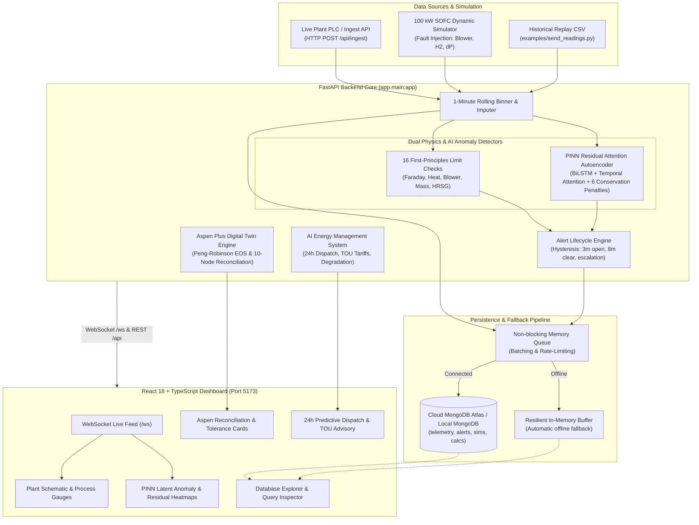

# SOFC Plant Utility Monitor

[](https://github.com/placeholder-owner/sofc-monitor/actions/workflows/ci.yml)
[](https://www.python.org/)
[](https://fastapi.tiangolo.com/)
[](https://react.dev/)
[](https://www.typescriptlang.org/)
[](https://vitejs.dev/)
[](LICENSE)

An industrial-grade digital twin, telemetry monitor, and physics-informed anomaly detection system for **Solid Oxide Fuel Cell (SOFC)** power plants. 

The system couples **16 real-time plant mass/energy/electrochemical balance checks** with an **Enhanced Physics-Informed Neural Network (PINN) Residual Autoencoder**, an **Aspen Plus Digital Twin reconciler**, an **AI Energy Management System (EMS)**, and an asynchronous **Cloud MongoDB Atlas** storage pipeline—accompanied by an interactive, low-latency **React + Vite** dashboard.

---

## 🏛 System Architecture



---

## 📂 Repository Layout

```
sofc-monitor/
├── .github/
│   └── workflows/
│       └── ci.yml               # Automated GitHub CI (Pytest & Vitest)
├── backend/                     # FastAPI backend & Deep Learning models
│   ├── app/                     # API routers, WebSocket, limit checks, DB & EMS
│   ├── aspen/                   # Aspen Plus verification models & Peng-Robinson EOS
│   ├── models/                  # Trained neural network weights and metadata
│   ├── scripts/                 # Benchmarking & model evaluation CLI tools
│   ├── sofc_ai/                 # PINN architecture, Huber loss, physics penalties
│   ├── tests/                   # Pytest test suite (unit, integration & stress)
│   ├── requirements.txt         # Python dependencies
│   ├── .env.example             # Backend environment template
│   └── README.md                # Backend technical guide
├── frontend/                    # Vite + React + TypeScript single-page application
│   ├── src/                     # React components, pages, hooks, state & types
│   ├── public/                  # Static assets
│   ├── package.json             # NPM dependencies and scripts
│   ├── vite.config.ts           # Vite proxy and build configuration
│   ├── .env.example             # Frontend environment template
│   └── README.md                # Frontend architecture guide
├── docs/                        # In-depth architectural & mathematical docs
│   ├── 01_DEEP_LEARNING_ARCHITECTURE.md
│   ├── 02_DATA_GENERATION_AND_TELEMETRY.md
│   ├── 03_MATHEMATICAL_LOSS_PREVENTION.md
│   ├── 04_PHYSICAL_RULES_AND_PINN.md
│   ├── 05_API_INTEGRATION.md
│   └── MODEL_ARCHITECTURE_WORKFLOW.md
├── examples/                    # Sample replay CSVs and HTTP telemetry senders
├── reports/                     # Benchmark execution reports & model metrics
├── .gitignore                   # Universal gitignore (Python, Node, Secrets, OS)
├── .gitattributes               # Cross-platform LF line ending normalization
├── CONTRIBUTING.md               # Contribution guidelines & code standards
├── LICENSE                      # MIT Open Source License
├── PROJECT.md                   # Complete system engineering specification
└── README.md                    # Root project documentation
```

---

## ⚡ Quick Start

### 1. Backend Service (FastAPI & Simulation Engine)

Requires **Python 3.10+** (Python 3.11 recommended).

```bash
cd backend

# Create virtual environment
python -m venv .venv
source .venv/bin/activate       # On Windows: .\.venv\Scripts\Activate.ps1

# Install dependencies
pip install -r requirements.txt

# Copy configuration
cp .env.example .env

# Start server (defaults to port 8000)
uvicorn app.main:app --reload --port 8000
```
- Interactive Swagger docs: [http://localhost:8000/docs](http://localhost:8000/docs)
- WebSocket telemetry stream: `ws://localhost:8000/ws`

### 2. Frontend Dashboard (React + TypeScript + Vite)

Requires **Node.js 18+**.

```bash
cd frontend

# Install dependencies
npm install

# Configure environment
cp .env.example .env

# Run development server with live HMR
npm run dev
```
Open [http://localhost:5173](http://localhost:5173) in your browser.

---

## ⚙️ Key Features & Modules

### 1. Dual Anomaly Detection Engine
Runs two complementary detection strategies simultaneously:
1. **16 First-Principles Physics Checks**: Calculates instantaneous plant balances in true engineering units (e.g. blower power vs. flow, cathode inlet delta, Faraday current, HRSG steam balance).
2. **Residual Temporal-Attention PINN Autoencoder**: Captures multivariate drift across all 19 plant telemetry channels with 6 coupled thermodynamic conservation loss penalties.

#### Physics Checks Inventory:
| Utility | Check | Warning Limit | Alarm Limit |
|---|---|---|---|
| **Hydrogen Supply** | H₂ flow vs stack demand | < -5% or > 5% | < -10% or > 10% |
| **Hydrogen Supply** | Fuel utilisation ($U_f$) | < 0.75 or > 0.85 | < 0.70 or > 0.88 |
| **Cathode Air & Blower** | Air flow vs heat balance | < -12% or > 8% | < -25% or > 15% |
| **Cathode Air & Blower** | Blower power vs flow | < -15% or > 10% | < -30% or > 25% |
| **Cathode Air & Blower** | Air ratio ($\lambda_{air}$) | < 8× or > 16× | < 6.5× or > 20× |
| **Stack Cooling & Temp** | Cathode temp rise ($\Delta T$) | > 103 K | > 108 K |
| **Stack Cooling & Temp** | Stack heat balance | < -6% or > 6% | < -12% or > 12% |
| **Stack Cooling & Temp** | Cathode inlet vs setpoint | < -12 K or > 12 K | < -25 K or > 25 K |
| **Stack Cooling & Temp** | Afterburner temperature | < 720 °C or > 900 °C | < 650 °C or > 1000 °C |
| **Electrical & Power** | DC power vs $I \times V$ | < -1.5 kW or > 1.5 kW | < -4.0 kW or > 4.0 kW |
| **Electrical & Power** | Net power balance | < -1.5 kW or > 1.5 kW | < -4.0 kW or > 4.0 kW |
| **Electrical & Power** | Stack voltage vs model | < -4% or > 8% | < -8% or > 11% |
| **Steam & Water (HRSG)** | Steam vs heat balance | < -10% or > 10% | < -20% or > 20% |
| **Steam & Water (HRSG)** | Flue gas leaving HRSG | < 115 °C or > 155 °C | < 100 °C or > 175 °C |
| **Differential Pressure** | Anode-cathode $\Delta P$ | < -5 or > 15 mbar | < -12 or > 30 mbar |
| **Differential Pressure** | Anode recycle vs expected | < -10% or > 10% | < -25% or > 25% |

### 2. Alert Lifecycle Management
- **Hysteresis Timing**: Prevents false positive noise. A limit check must persist out-of-band for **3 minutes** to open an alert, and remain within band for **8 continuous minutes** to clear.
- **Learned Model Confirmation**: Requires 3 flagged 5-minute steps (15 minutes total).
- **Escalation Logic**: Alerts escalate seamlessly from `Warning` to `Alarm` upon severe excursions while un-acknowledging operator state.

### 3. Aspen Plus Digital Twin & PR-EOS Reconciliation
- Reconciles live sensor measurements against rigorous Peng-Robinson thermodynamic state predictions.
- Tracks 10 key mass and energy nodes across the plant with tolerance error envelopes.
- Identifies optimal operating candidates under fluctuating electrical load and CHP demands.

### 4. Cloud MongoDB Atlas Integration & Resilient Buffer
- Asynchronous non-blocking writer batches telemetry ticks into MongoDB collections (`telemetry_ticks`, `alerts`, `simulations`, `thermo_calculations`).
- Automatic failover: If internet or MongoDB connection drops, the system transitions to an in-memory ring buffer with zero data loss or telemetry dropouts.

---

## 📡 Ingesting Real Telemetry

To stream external telemetry into the monitor from real PLC hardware or DCS:

```bash
curl -X POST http://localhost:8000/api/ingest \
  -H "Content-Type: application/json" \
  -d '{
    "ts": "2026-03-01T06:00:00Z",
    "source": "plc-node-1",
    "values": {
      "h2_flow_kg_h": 8.1,
      "i_stack_A": 236.0,
      "v_stack_V": 340.2,
      "air_flow_kg_h": 128.0,
      "t_cathode_in_C": 650.0,
      "t_cathode_out_C": 745.0,
      "p_anode_mbar": 25.0,
      "p_cathode_mbar": 20.0
    }
  }'
```

Or replay an included sample dataset using the provided script:
```bash
python examples/send_readings.py --csv examples/sample_normal_then_blower_fade.csv --interval 0.2
```

---

## 🧪 Testing & Verification

### Backend Automated Tests
```bash
cd backend
pytest -v
```

### Frontend Automated Tests & Typecheck
```bash
cd frontend
npm run typecheck    # Contract validation with tsc
npm test             # Vitest test suites (113+ assertions)
npm run build        # Production bundle build test
```

---

## 🚀 Pushing to Your GitHub Repository

To upload this project to your GitHub account:

```bash
# 1. Initialize git repository (if not already initialized)
git init -b main

# 2. Stage all project files (safe from .env, .venv, node_modules)
git add .

# 3. Create your initial commit
git commit -m "feat: initial commit for SOFC plant utility monitor"

# 4. Link your remote repository
git remote add origin https://github.com/<your-username>/<your-repo-name>.git

# 5. Push to GitHub
git branch -M main
git push -u origin main
```

---

## 📄 License

This project is licensed under the **MIT License** - see the [LICENSE](LICENSE) file for details.
